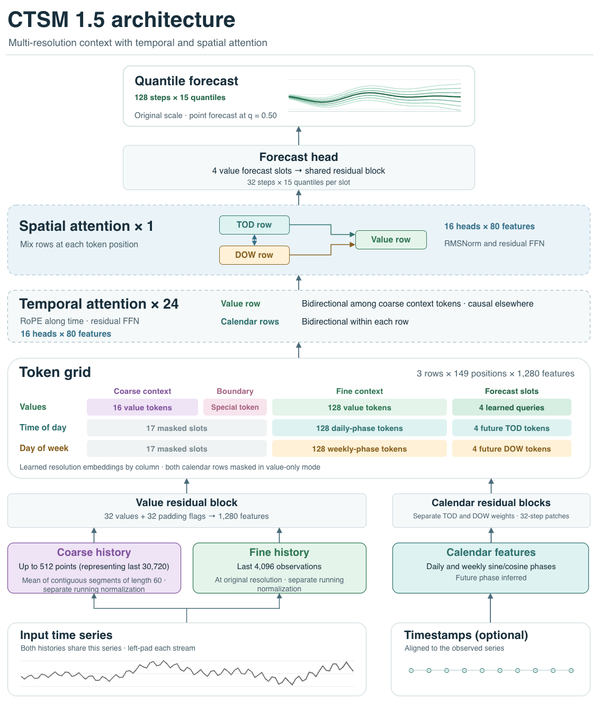

# Cisco Time Series Model

[](https://arxiv.org/abs/2511.19841)
[](https://huggingface.co/cisco-ai/cisco-time-series-model-1.0)
[](https://opensource.org/licenses/Apache-2.0)

## Latest Release (250M) - [CTSM 1.5](https://huggingface.co/cisco-ai/cisco-time-series-model-1.5)

CTSM 1.5 builds on the [CTSM 1.0](https://huggingface.co/cisco-ai/cisco-time-series-model-1.0) model, keeping its multiresolution context design, and with an increased focus on seasonality. We place particular emphasis on seasonal structures (daily, weekly and other periodic patterns) present in machine (e.g., observability, networking) data.


<p align="center">
  
</p>

## Results and Improvements (ranked by MASE ↓)

### O11y

| Model | MASE ↓ | CRPS ↓ |
|---|---:|---:|
| **CTSM-1.5** | **0.298** | **0.019** |
| Toto-2.0-313M | 0.319 | 0.020 |
| CTSM-1.0 | 0.328 | 0.021 |
| TimesFM-3 | 0.345 | 0.022 |
| Chronos-2 | 0.403 | 0.025 |

### O11y-Seasonal

| Model | MASE ↓ | CRPS ↓ |
|---|---:|---:|
| **CTSM-1.5** | **0.404** | **0.030** |
| Toto-2.0-313M | 0.427 | 0.031 |
| TimesFM-3 | 0.458 | 0.033 |
| CTSM-1.0 | 0.500 | 0.037 |
| Chronos-2 | 0.503 | 0.037 |

### GIFT-Eval

| Model | MASE ↓ | CRPS ↓ |
|---|---:|---:|
| TimesFM-3 | 0.667 | 0.456 |
| **CTSM-1.5** | **0.689** | **0.478** |
| Chronos-2 | 0.698 | 0.485 |
| Toto-2.0-313M | 0.703 | 0.481 |
| CTSM-1.0 | 0.766 | 0.548 |

**Evaluation notes**

- **O11y benchmarks:** The (internal) O11y benchmarks have been updated for this release, in particular with longer context. They still follow the same constraints as before: the evaluation data is **out-of-domain** (no part of the series appears in training) and **in-the-future** (falls after the training data period across all time series).
- We define seasonality through the **STL decomposition**: a series is considered seasonal when the seasonal component accounts for a substantial share of its variance. The **O11y-Seasonal** benchmark is the subset of the O11y benchmark identified by this criterion.
- **GIFT-Eval protocol:** We follow the standard GIFT-Eval protocol. Timestamps are used whenever they are available.

## What's New (in addition to the CTSM 1.0 innovations)

### Model Architecture

- **Running normalization** uses the patches up to and including the current patch to compute its statistics in each resolution. The forecast head uses the final fine-context statistics to reverse this normalization.
- **Longer context** combines up to 4,096 observations at the original cadence and up to 512 coarse means. Each coarse mean covers 60 observations. Both views end at the same forecast origin and can overlap.
- **Calendar covariates** use separate time-of-day and day-of-week rows aligned with the fine context. The decoder applies 24 time-attention layers followed by one layer that lets the value row attend to the calendar rows. Value-only mode masks both calendar rows.
- **Horizon patch decoding** uses a shared residual head on four learned queries. Each query outputs 15 quantiles for 32 future steps, giving 128 steps per decoder pass. When timestamps are supplied, the model extrapolates future calendar features from the last two observed timestamps and uses them to condition the forecast.

### Training Methods

- **Median point forecast** uses the 0.5 quantile as the point prediction.
- **Warmup-stable-decay (WSD) cycles:** Continual training runs in WSD cycles, with careful data scheduling within each cycle.

### Training Data

- **More training resolutions** from the Observability domain, and **heterogeneous training**, i.e., mixing data with and without timestamps.
- **A richer set of synthetic data generators**, aimed at the seasonality structures found in machine data.
- **Adversarial data generation** in some WSD cycles via Multi-armed bandit (MAB) sampling.

### Inference-Time Controls

- **Three-path decoding** shares the first 128-step block and uses independent P25, P50, and P75 feedback paths for subsequent blocks. The model pools their quantiles beyond the first block.
- **Quantile sorting** orders the 15 output quantiles at every step after optional flip equivariance and before clipping and snapping. P50 is taken from the sorted forecast.
- **Clipping/snapping** clips negative forecasts to zero or rounds forecasts to integers when the observed series meets the corresponding condition.
- **Flip equivariance** averages forecasts from the original and negated histories using complementary quantiles. It is enabled by default and can be disabled with `flip_equivariance=False`.

Calendar features activate when timestamps or a start time and cadence are supplied. Set `use_timestamps=False` for value-only forecasts or `use_timestamps=True` to require a clock.

### Quickstart

Install CTSM 1.5 from [PyPI](https://pypi.org/project/cisco-tsm/) in a Python 3.11 or newer environment.

```shell
python -m pip install 'cisco-tsm>=1.0.3'
```

For a specific CPU or CUDA build, install the [PyTorch wheel for your platform](https://pytorch.org/get-started/locally/) first. Use `python -m pip install 'cisco-tsm[notebooks]>=1.0.3'` for the plotting examples.

This example creates five days of hourly observations and forecasts the next 24 hours with and without timestamps. `start_time` is the timestamp of the first observation.

```python
import numpy as np
from ctsm_1p5.modeling import load_model

model = load_model(huggingface_repo_id="cisco-ai/cisco-time-series-model-1.5")

hours = np.arange(5 * 24, dtype=np.float32)
history = 30 + 12 * np.sin(2 * np.pi * (hours - 7) / 24)

## Example 1: With just clock
with_clock = model.forecast(
    history, horizon_len=24, start_time="2025-01-06T00:00:00", freq="h",
)[0]

print("P50 with clock", with_clock["quantiles"]["0.5"][:3].round(2))

## Example 2: Without any timestamps, just values
values_only = model.forecast(history, horizon_len=24)[0]

print("P50 with values only", values_only["quantiles"]["0.5"][:3].round(2))

## Example 3: We can also pass one timestamp per observation
start = np.datetime64("2025-01-06T00:00")
timestamps = start + np.arange(len(history)) * np.timedelta64(1, "h")
with_timestamps = model.forecast(history, horizon_len=24, timestamps=timestamps)[0]

print("P50 with timestamps", with_timestamps["quantiles"]["0.5"][:3].round(2))
```

The example prints the median for the first three forecast hours. Each forecast returns 15 quantile curves, with one value per future hour. The `mean` field holds the median point forecast and equals `quantiles["0.5"]`.

The [timestamp comparison notebook](ctsm_1p5/notebooks/timestamp_forecast_comparison.ipynb) shows how calendar inputs affect a weekend traffic forecast. More examples cover [CPU utilization](ctsm_1p5/notebooks/cpu_utilization_forecast.ipynb), [internet traffic](ctsm_1p5/notebooks/internet_traffic_forecast.ipynb), and [server response time alerts](ctsm_1p5/notebooks/alerting_server_responsetime.ipynb).

From the repository checkout, download the notebook weights with:

```shell
hf download cisco-ai/cisco-time-series-model-1.5 model.safetensors --local-dir checkpoints
```

## Previous Release (250M) - CTSM 1.0

[README](1.0/README.md) | [Model Card](https://huggingface.co/cisco-ai/cisco-time-series-model-1.0)

## Citation
If you find Cisco Time Series Model useful for your research, please consider citing the associated technical report:
```
@misc{gou2025ciscotimeseriesmodel,
      title={Cisco Time Series Model Technical Report},
      author={Liang Gou and Archit Khare and Praneet Pabolu and Prachi Patel and Joseph Ross and Hercy Shen and Yuhan and Song and Jingze Sun and Kristal Curtis and Vedant Dharnidharka and Abhinav Mathur and Hao Yang},
      year={2025},
      eprint={2511.19841},
      archivePrefix={arXiv},
      primaryClass={cs.LG},
      url={https://arxiv.org/abs/2511.19841},
}
```

## Authors:
- Liang Gou \*
- Archit Khare \*
- Praneet Pabolu \*
- Prachi Patel \*
- Joseph Ross \*
- Hercy Shen \*‡
- Yuhan (Ellen) Song \*
- Jingze Sun \*
- Kristal Curtis †
- Vedant Dharnidharka †
- Abhinav Mathur †
- Hao Yang †

\* These authors contributed equally to the core development of this work, listed alphabetically by last name. <br>
† These authors contributed equally to supporting and extending this work, listed alphabetically by last name.<br>
‡ Hercy Shen contributed to this work while an intern at Splunk.<br>

## License
This project is licensed under the Apache-2.0 License. See the [LICENSE](https://github.com/splunk/cisco-time-series-model/blob/main/LICENSE) file for more details.
